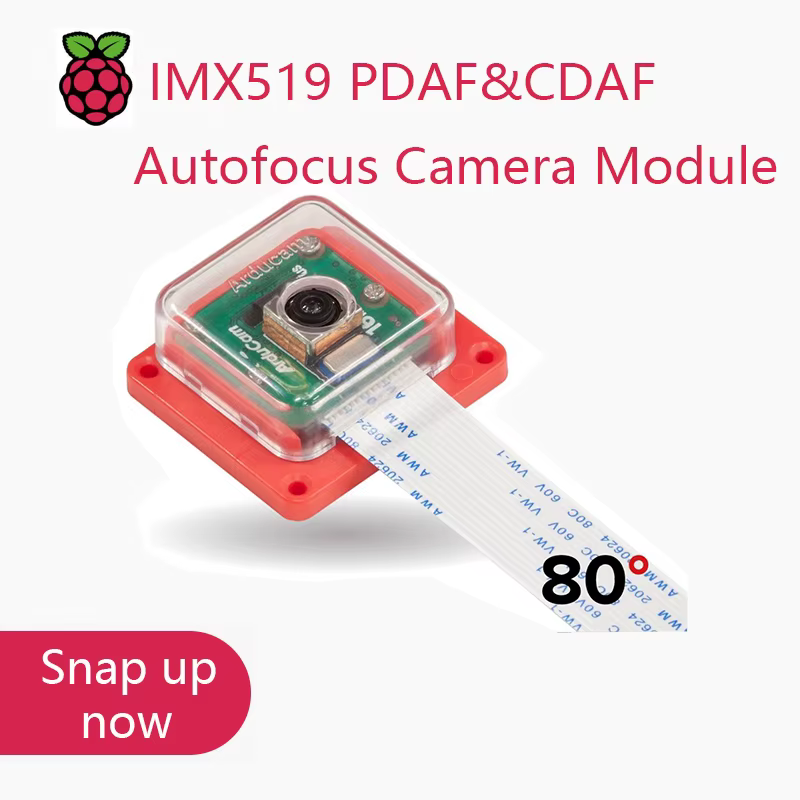

# Arducam IMX519 Autofocus

Документация камеры Arducam IMX519 с автофокусом и объективом **80°**:
характеристики, распиновка, исходные материалы и запуск на SBC и микроконтроллерах.
Камера имеется у владельца. На Radxa Dragon Q6A зафиксированы RAW/цветной
захват, ручной и контрастный автофокус; экспериментальный PDAF имеет
короткие физические проверки и открытые критерии квалификации. Точный SKU
и физическая ревизия экземпляра остаются неподтверждёнными.

## Камера

| Параметр | Имеющиеся сведения |
| --- | --- |
| Выбранный вариант | Цветная Sony IMX519, автофокус, объектив 80° |
| Модуль на изображениях продавца | UC-875 Rev.B, 15 видимых паяных контактов разъёма |
| Изображение | 4656 × 3496, около 16,3 Мп, rolling shutter |
| Интерфейс | Две линии MIPI CSI-2 по руководству Arducam |
| Распиновка | Стандартный 15-контактный интерфейс и сопоставление с 22-контактным RPi; ревизию и ориентацию своего разъёма нужно проверить |
| Проверка работы | Q6A CAM3, Ubuntu 24.04.4 LTS / `7.0.11-6-qcom`: RAW/RGB, ручной фокус и CDAF; короткий опытный PDAF. Результаты привязаны к сохранённым версиям, новому ядру не приписываются |



B0371 используется как справочный модуль производителя. Точный артикул
Arducam для имеющегося экземпляра не подтверждён. Вариант B0500 имеет
собственные характеристики и комплект кабелей; их нельзя автоматически
приписывать плате UC-875 Rev.B.

## Найти нужное

| Задача | Документ |
| --- | --- |
| Характеристики, объектив, поток данных | [Справочник модуля](docs/reference/module.md) |
| Подключение шлейфа | [Распиновка 15/22 контакта](docs/reference/pinout.md) |
| Выбрать стек захвата и управления фокусом | [Справочник драйверов](docs/reference/drivers.md) |
| Подготовить запуск на Raspberry Pi | [Разработка подключения Raspberry Pi](target/sbc/raspberry_pi/README.md) |
| Найти запуск на Q6A или подготовку Jetson | [Radxa Dragon Q6A](target/sbc/radxa_dragon_q6a/README.md), [NVIDIA Jetson](target/sbc/nvidia_jetson/README.md) |
| Найти все SBC и микроконтроллеры | [Целевые платформы](target/README.md) |
| Проверить исходные документы | [Оригиналы и происхождение](docs/vendor/README.md) |

[Каталог документации](docs/README.md) показывает статус каждого маршрута.
[Проверенный рецепт Q6A](docs/guides/sbc/radxa_dragon_q6a.md) связывает
команды с исходными результатами. Остальные маршруты сохраняют свой статус
разработки. [Задача PDAF 00214](docs/development/00214-qualify-q6a-imx519-pdaf.md)
остаётся deferred P2; [замечание об отложенной паузе](docs/development/q6a-pdaf-deferred-pause.md)
остаётся открытым.

## Работа с репозиторием

```sh
git clone git@github.com:pOmelchenko/camera_imx519.git
cd camera_imx519
```

```text
docs/
  reference/    характеристики, распиновка, драйверы
  vendor/       оригинальные файлы, происхождение и SHA-256
  development/  состояние разработки и критерии проверки
  guides/       рецепты для физически проверенных конфигураций
target/
  sbc/<board>/  подключение, код, патчи и результаты для SBC
  mcu/<board>/  подключение, код, патчи и результаты для микроконтроллера
```

После аппаратной проверки маршрут оформляется в `docs/guides/<kind>/<board>.md`
с точной конфигурацией, командами и проверяемым результатом. Настройка ОС
и общие интерфейсы SBC описываются в репозитории платы; соединение, драйвер
и управление фокусом этой камеры — здесь. Скрипты и патчи добавляются вместе
с реальной работой под соответствующим SBC. Локальные сборки и зависимости
исключены из Git.

Из `docs/vendor` целостность оригиналов проверяется на macOS командой
`shasum -a 256 -c SHA256SUMS`, на Linux — `sha256sum -c SHA256SUMS`.
